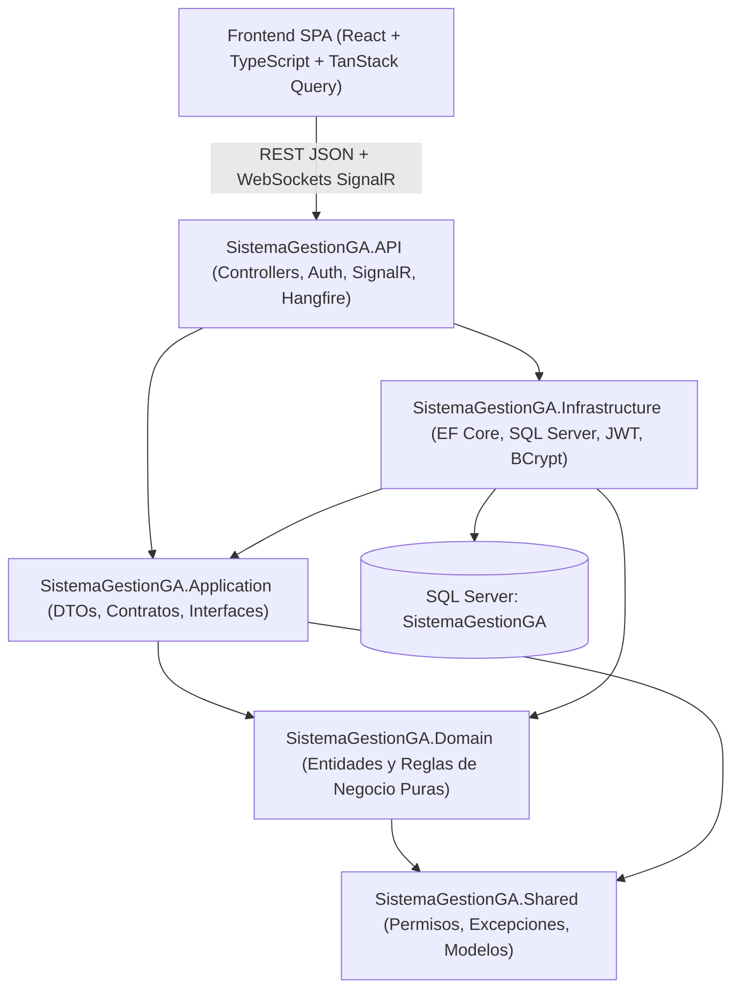

# Arquitectura del Sistema de Gestión GA

## 1. Estilo Arquitectónico
El sistema implementa una **Arquitectura Monolítica Modular basada en Clean Architecture**, garantizando separación estricta de responsabilidades, alta cohesión por dominio funcional y bajo acoplamiento entre la capa de presentación, las reglas de negocio y la infraestructura de persistencia.

## 2. Capas del Backend
1. **`SistemaGestionGA.Shared`**: Contiene el catálogo maestro de permisos (`PermisosConstantes`), excepciones de dominio tipadas (`DomainRuleException`, `ForbiddenScopeException`) y contenedores de paginación.
2. **`SistemaGestionGA.Domain`**: Contiene las 30+ entidades del modelo relacional y el servicio de dominio puro `ReglasNegocioService` (detección de dependencias circulares mediante recorrido BFS en grafos dirigidos, validación de transiciones de estado, cálculo ponderado de avances y motor de fechas límite y evaluación SLA).
3. **`SistemaGestionGA.Application`**: Define los contratos `ICurrentUserService` e `IRealtimeNotificationService`, así como todos los DTOs de entrada y salida validados con DataAnnotations.
4. **`SistemaGestionGA.Infrastructure`**: Implementa `ApplicationDbContext` (Entity Framework Core para SQL Server), migraciones versionadas, `DatabaseInitializer` y `JwtTokenService` (emisión de JWT HS256 y rotación de Refresh Tokens con hash SHA-256).
5. **`SistemaGestionGA.API`**: Expone los controladores REST organizados por módulo, el proveedor dinámico de políticas de autorización por permiso (`PermisoPolicyProvider`), el hub SignalR `/hubs/notificaciones`, el trabajo recurrente Hangfire `SlaMonitorJob` y el middleware centralizado `GlobalExceptionMiddleware`.

## 3. Seguridad y Aislamiento Multi-Unidad
- **Autenticación**: JWT de corta duración acompañado de Refresh Tokens rotativos y revocables almacenados únicamente como hash SHA-256 en la tabla `RefreshTokens`.
- **Protección contra Fuerza Bruta**: Bloqueo temporal automático de cuenta (`BloqueadoHastaUtc`) tras 5 intentos fallidos consecutivos y bitácora completa en `HistorialAccesos`.
- **Autorización Basada en Permisos en Base de Datos**: Ningún permiso está hardcodeado exclusivamente en el frontend; cada endpoint exige `[RequierePermiso("modulo.accion")]` evaluado en el backend.
- **Alcance por Unidad de Negocio (Anti-IDOR)**: Todo recurso operativo (`Proyecto`, `Actividad`, `Ticket`, `Equipo`, `Departamento`, `Adjunto`) pertenece a una `UnidadId`. `ICurrentUserService.ExigirAlcanceUnidad(unidadId)` valida en cada operación que el usuario tenga asignada la unidad o posea `AccesoGlobalUnidades = true`, bloqueando con `403 Forbidden` cualquier intento de manipulación de identificadores en URL o parámetros.
