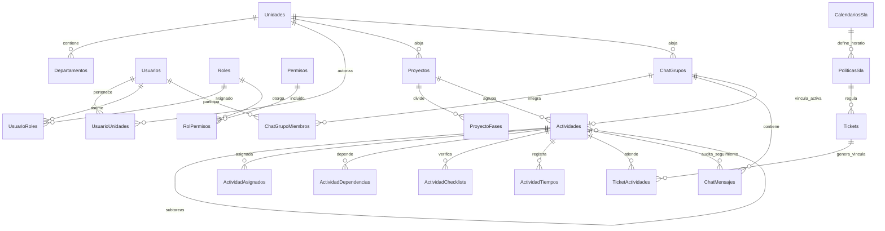

# Modelo de Datos Relacional (SQL Server)

## 1. Análisis y Mejora sobre el Modelo Inicial v0.1
Se conservaron íntegramente las 26 tablas del modelo inicial de referencia (`database/scripts/SistemaGestionGA_Modelo_SQL_v0_1.sql`) y se normalizó y enriqueció el esquema hasta conformar el **Modelo Relacional Definitivo v1.0** (`database/scripts/SistemaGestionGA_Modelo_SQL_v1_0_Definitivo.sql`), compuesto por **38 tablas** con integridad referencial e índices de cobertura.

### Entidades Añadidas y Enriquecimientos Clave
1. **`HistorialAccesos`**: Bitácora dedicada de intentos de inicio de sesión (exitosos y fallidos), IP, User-Agent y motivo.
2. **`ProyectoFases` y `ProyectoIntegrantes`**: Soporte formal para fases, hitos (`EsHito`) y equipo de proyecto con roles específicos.
3. **`ActividadChecklists`**: Ítems verificables dentro de cada actividad que alimentan automáticamente el cálculo del porcentaje de avance.
4. **`ActividadTiempos`**: Registro de minutos reales trabajados por colaborador y fecha para análisis de productividad y carga de trabajo.
5. **`ActividadHistorial` y `TicketHistorial`**: Trazabilidad cronológica específica de cambios de estado, reasignaciones, respuestas y resoluciones.
6. **`CalendariosSla` y `DiasFestivosSla`**: Configuración de horarios de atención, zona horaria, días laborales e inhábiles para cálculo preciso de SLA.
7. **`Notificaciones`**: Bandeja persistente de alertas internas en tiempo real sincronizada con SignalR.
8. **`ReglasAutomatizacion`**: Motor de reglas configurables (`CUANDO EventoDisparador SI CondicionJson ENTONCES AccionTipo`) con contadores de ejecuciones y fallos.

## 2. Diagrama Entidad-Relación Principal

## 3. Tablas del Módulo de Chat WhatsApp
1. **`ChatGrupos`**: Canales de chat por unidad (`Id`, `Nombre`, `Descripcion`, `UnidadId`, `CreadoPorId`, `Activo`, `ActividadActivaId`, etc.).
2. **`ChatGrupoMiembros`**: Integrantes del grupo con clave compuesta (`ChatGrupoId`, `UsuarioId`, `EsAdmin`, `FechaUnionUtc`).
3. **`ChatMensajes`**: Historial de mensajes tipo texto, sistema, preguntas y respuestas interactivas (`TipoMensaje`, `OpcionesInteractivasJson`, `OpcionSeleccionada`, `RespondidoPorUsuarioId`, `FechaRespuestaUtc`, etc.).
4. **Vinculación con `Actividades`**: `Actividades.ChatGrupoId` permite que los mensajes de chat actualicen en tiempo real la actividad y que respuestas interactivas marquen la resolución al 100%.

## 4. Reglas de Integridad en SQL Server
- Todas las fechas de auditoría y eventos se almacenan en **UTC** (`DATETIME2` con `SYSUTCDATETIME()`).
- Se configuraron comportamientos `ON DELETE RESTRICT` en relaciones cruzadas entre `Unidades`, `Proyectos`, `Actividades` y `Tickets` para evitar rutas de cascada múltiples en SQL Server y proteger la integridad histórica.
